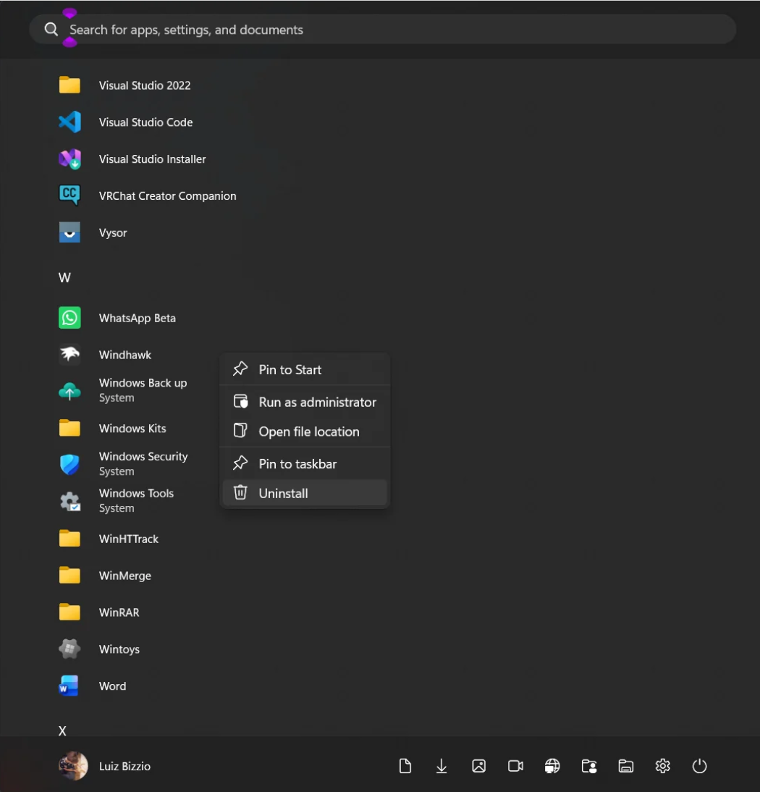

# Uninstall Here

Open desktop app uninstallers directly from the **Windows 11 Start menu**, without opening Settings or Control Panel.

## Features

- Uses the existing **Uninstall** command in Start.
- Shows the registered product name and, when available, the publisher before you confirm.
- Opens Windows Installer in uninstall mode for matching MSI products.

## Installation

1. Install [Windhawk](https://windhawk.net/) if you do not already have it.
2. When the mod is available, open the [Uninstall Here page](https://windhawk.net/mods/uninstall-here) or search for **Uninstall Here** in Windhawk.
3. Click **Install**.

## How to use

1. Open **Start** and go to **All apps**.
2. Right-click a desktop app and select **Uninstall**.
3. Check the product name, confirm, and follow the uninstaller's prompts.

## Compatibility and limitations

- Requires **64-bit Windows 11**. The **All apps** flow was tested on x64 build `26300.10075`.
- Windows handles packaged apps and desktop apps that the mod can't match to a single installation.
- Windows may ask for administrator approval when the uninstaller needs it.

## Troubleshooting

If a desktop app still sends you to **Settings > Apps > Installed apps**, enable logging for **Uninstall Here** in Windhawk and repeat the click. [Open an issue](https://github.com/luizbizzio/uninstall-here/issues) with the app name and version, your Windows build from `winver`, and the mod's log entries.

## Author and license

Created by **[Luiz Bizzio](https://github.com/luizbizzio)**. [Sponsor this project](https://github.com/sponsors/luizbizzio)

Licensed under the **Apache License 2.0**. See [LICENSE](LICENSE).
